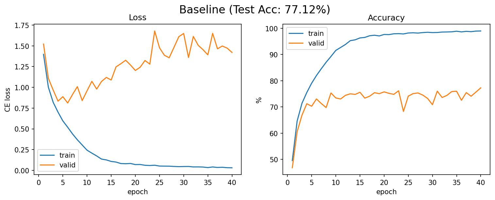
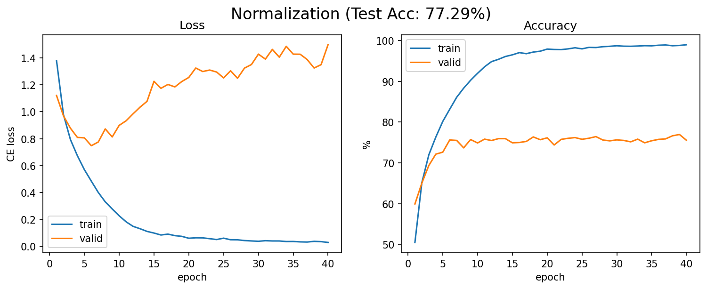
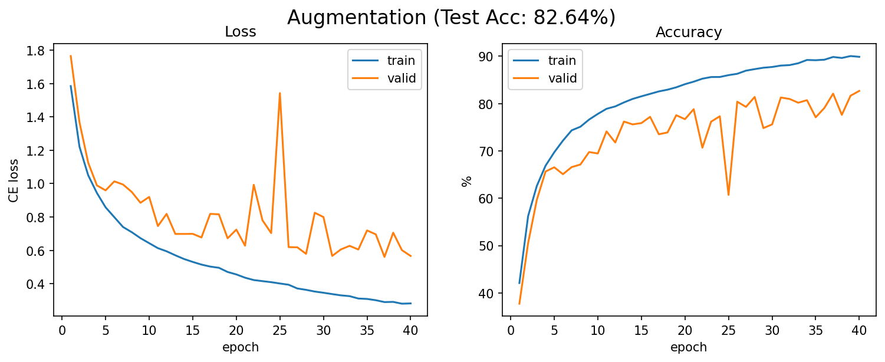
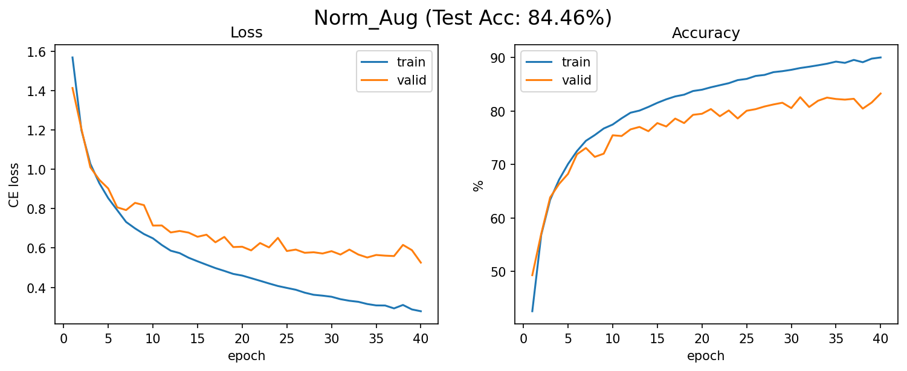
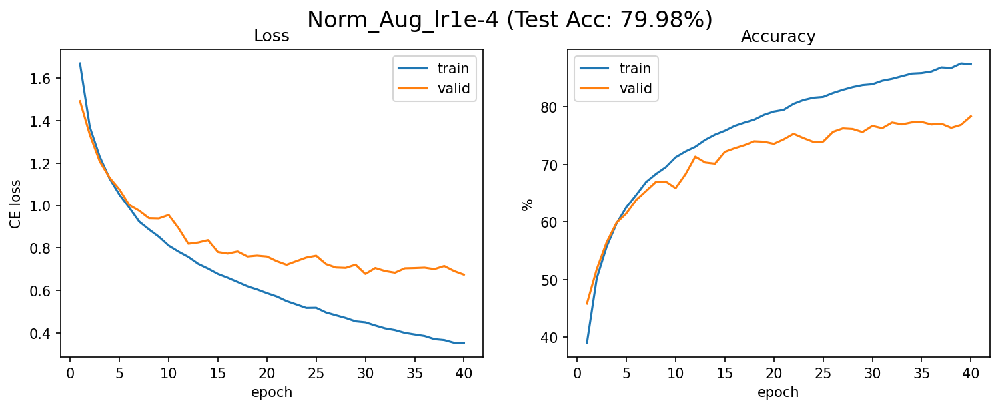
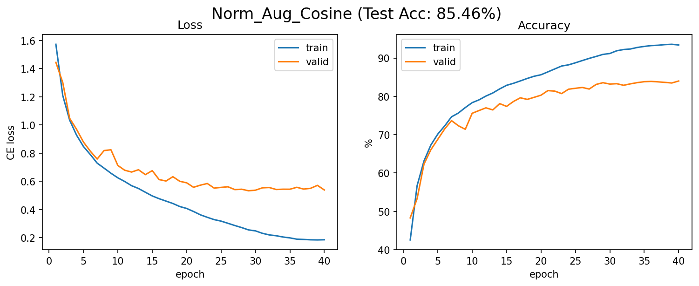
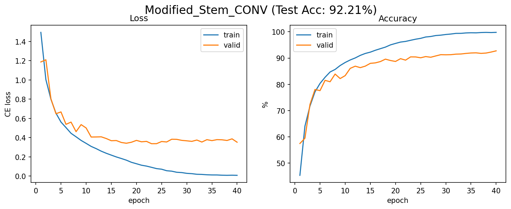

# Experiments Results
Author: Hsu, Chao-Lin 

Date: 2026.10.15

Description: This is the experiment results on ResNet18. 

## Summary

All experiments: ResNet18, Adam, batch size = 128, epoch = 40, seed = 43.

| # | Experiment | Stem | Normalization | Augmentation | LR Strategy | Test Acc | Best Val Acc (epoch) | Final Train Acc | Final Train−Val Gap |
|---|---|---|:---:|:---:|---|---:|---:|---:|---:|
| 1 | Baseline | ImageNet | ✗ | ✗ | Fixed 1e-3 | 77.12% | 77.28% (40) | 98.96% | 21.68% |
| 2 | Normalization | ImageNet | ✓ | ✗ | Fixed 1e-3 | 77.29% | 76.96% (39) | 98.97% | 23.43% |
| 3 | Augmentation | ImageNet | ✗ | ✓ | Fixed 1e-3 | 82.64% | 82.68% (40) | 89.88% | 7.20% |
| 4 | Norm + Aug | ImageNet | ✓ | ✓ | Fixed 1e-3 | 84.46% | 83.26% (40) | 90.01% | 6.75% |
| 5 | Norm + Aug, lr=1e-4 | ImageNet | ✓ | ✓ | Fixed 1e-4 | 79.98% | 78.40% (40) | 87.40% | 9.00% |
| 6 | Norm + Aug, Cosine | ImageNet | ✓ | ✓ | Cosine 1e-3 → 0 (T_max=40) | 85.46% | 84.00% (40) | 93.40% | 9.40% |
| 7 | Modified Stem CONV | **CIFAR** | ✓ | ✓ | Cosine 1e-3 → 0 (T_max=40) | **92.21%** | **92.74%** (40) | 99.78% | 7.04% |

- Stem:
  - ImageNet = Conv 7×7, stride 2 + MaxPool 3×3, stride 2 (32×32 input → 8×8 before layer1)
  - CIFAR = Conv 3×3, stride 1, no MaxPool (32×32 input → 32×32 before layer1)
- Experiment 4 also serves as the fixed lr = 1e-3 baseline for the learning rate comparison (4, 5, 6).
- Experiment 7 changes only the stem compared with experiment 6.

| Stem | Params | MACs (thop, 1×3×32×32 input) |
|---|---:|---:|
| ImageNet | 11,181,642 | 37.22 M |
| CIFAR | 11,173,962 | 557.89 M |

- Final Train−Val Gap = train acc − val acc at epoch 40.

## Task 2 Baseline
- No image normalization
- No data augmentations
- lr = 1e-3, batch size = 128, epoch = 40

### Result
- Best Model Test Accuracy: 77.12%

Val loss 從 0.81 升到 1.4 以上，但 val acc 並沒有下降，反而還微幅上升。為什麼？
accuracy 只看 argmax 對不對，Cross-Entropy 則會看模型對正確類別給了多少機率。想想看，一個越來越「自信」的模型，在猜錯的那些樣本上，CE loss 會怎麼變化？

## Task 2 Normalization
- No data augmentations
- lr = 1e-3, batch size = 128, epoch = 40

### Results
- Best Model Test Accuracy: 77.29%

## Task 2 Data Augmentation (RandomCrop, RandomHorizontalFlip)
- No image normalization
- lr = 1e-3, batch size = 128, epoch = 40

### Results
- Best Model Test Accuracy: 82.64%

最後幾個 epoch，train acc 和 val acc 都還在往上爬，val loss 的最低點也出現在很後期。這代表 40 個 epoch 對這組來說不夠，因為訓練資料變難了，模型需要更多 epoch 才學得起來。

## Task 2 Normalization + Data Augmentation (RandomCrop, RandomHorizontalFlip)
- lr = 1e-3, batch size = 128, epoch = 40

### Results
- Best Model Test Accuracy: 84.46%

## Task 2 Different Learning Rate (fixed lr=1e-3, 1e-4, CosineAnnealing lr=1e-3, T_Max=40 )
- with image normalization and data augmentations
- batch size = 128, epoch = 40

### Results
- Best Model Test Accuracy (lr=1e-3): 84.46%

- Best Model Test Accuracy (lr=1e-4): 79.98%

- Best Model Test Accuracy (CosineAnnealing with lr=1e-3, T_Max=40): 85.46%

## Task 2 Modified Stem CONV (CosineAnnealing lr=1e-3, T_Max=40)

- Best Model Test Accuracy: 92.21%

Note: we call scheduler.step() at the end of each epoch

## Learning Reflection

### Dataset

**Q1.** 將影像資料進行 Normalization，使其均值趨近於 0、標準差趨近於 1，對 optimizer 尋找最佳解有什麼幫助？

**Ans:**

**Q2.** 請說明 Validation Set 與 Test Set 在模型訓練過程中所扮演的不同角色為何？

**Ans:**

### NN Layer

回顧 Linear layer 的 `forward()`, `backward()` 實作

**Q1.** 假設上一層傳遞下來的梯度為 $dy$，輸入為 $x$，請寫出權重矩陣 $W$ 與偏差值 $b$ 的梯度數學推導結果。

**Ans:**

**Q2.** 為什麼在更新參數時，我們需要暫存 forward pass 的輸入 $x$？

**Ans:**

### Training loop

**Q1.** 解釋 Training 過程中的四個核心步驟各自的功能：`forward propagation`, `compute loss`, `backward propagation`, `update parameters`

**Ans:**

**Q2.** Lab1-2 中，用來選擇 best_resnet18.pth 的指標為何 (Train acc / Val acc / Test acc)？為什麼選用該指標，而不是其他兩個？

**Ans:**

### ResNet

實作 `BasicBlock` 時，最大的重點在於 Shortcut Connection（殘差連接）。

**Q1.** 解釋這個結構如何解決深層網路中的「梯度消失（Vanishing Gradient）」問題

**Ans:**

**Q2.** Convolution block 中 shortcut 上的 conv layer 功能為何？

**Ans:**

### Hyperparameter Tuning

在訓練之前需要自行設定 `BATCH_SIZE`, `EPOCH`, `lr`, `weight_decay` 等超參數

**Q1.** 假設觀察到模型在 Training Set 上的 Loss 持續且穩定地下探，但在 Validation Set 上的 Accuracy 卻停滯不前，甚至 Loss 開始反向升高。這代表模型發生了什麼現象？

**Ans:**

**Q2.** 承上題，在不更改模型架構的前提下，你會優先調整哪些超參數，或是引入什麼樣的訓練策略來緩解這個問題？為甚麼？

**Ans:**