# Lab 3 - Model Quantization
:::spoiler 點我展開文章目錄
[TOC]
:::

##  Lab Objectives
* Understand why quantization is needed in deep learning.
* Learn different quantization schemes.
* Explore the trade-off between accuracy and efficiency.
* Gain hands-on experience with Post-Training Quantization (PTQ) and Quantization-Aware Training (QAT).

---

## 1. Why Quantization?

### 1.1 Motivation for Quantization
In recent years, the scale of large language models (LLMs) has continued to soar, with parameter counts ranging from tens to hundreds of billions, as shown below. For example, Meta's Llama 3 series includes models with 8B, 70B, and even larger 405B parameters that are publicly available. When performing inference in FP16/bfloat16, the weights alone can occupy tens of gigabytes of GPU memory. Adding intermediate activations increases memory pressure and I/O transfer costs, creating speed and energy consumption bottlenecks.
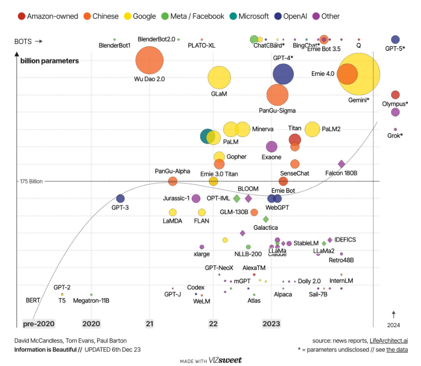

### 1.2 Impact of Increasing Model Parameters
Deep neural networks (DNNs) are often trained and deployed using 32-bit floating point. However, FP32 is not always efficient for:
* **Latency:** FP32 matrix multiplications consume more cycles than int8.
* **Memory footprint:** The weights and activations of FP32 require 4× storage of int8.
* **Hardware compatibility:** Edge or IoT devices have limited resources. Besides, more chip areas need more money to do it.
* **Power consumption:** Memory access often dominates power consumption; using int8 reduces both bandwidth and power consumption. Further details will be explained during AOC next semester.
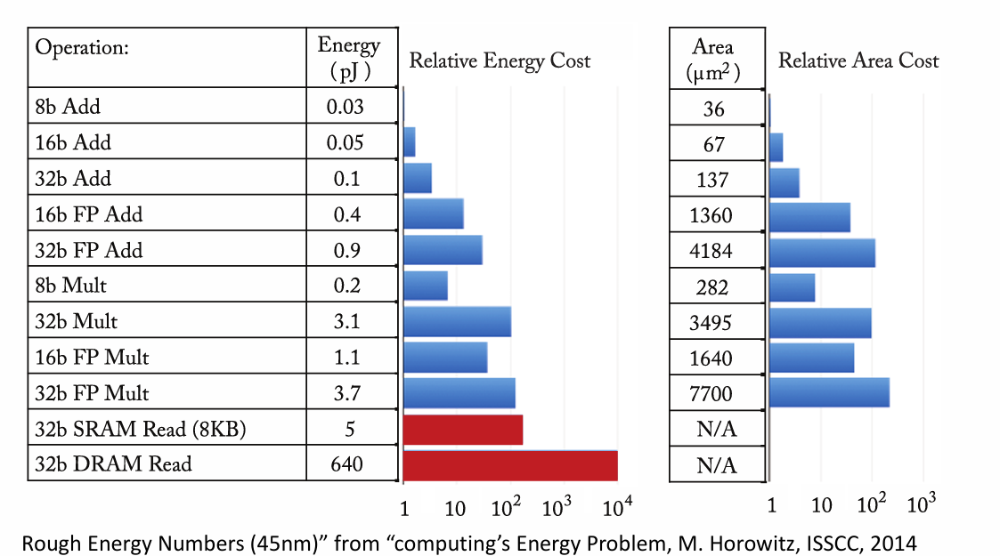

> **Tip**
> From the chart above, we can see that floating-point arithmetic is more computationally expensive due to the overhead of mantissa alignment and multiplications.

---

## 2. What is Quantization?
Quantization(量化) is the process of converting abstract concepts into numbers.

### 2.1 Illustrating Quantization
"How hardworking were you today, Jackie?"
"I wrote 30 lines of code today. Super diligent!"
Here, "how hardworking" is an abstract concept, and we quantify it using a concrete number—30 lines of code. Of course, this kind of quantification can ignore other efforts, like thinking, debugging, or discussions, which introduce some errors.

### 2.2 Quantization with Different Scales
Quantization also applies to data in AI. For example, Figure 1 shows a high-resolution image from a camera, which takes up 35MB of storage. Figure 2 shows a compressed version of the same image, only 541KB. Although some details are lost, we can still clearly recognize the object as a rock.
| Example | Figure 1 | Figure 2 |
| :--- | :--- | :--- |
| Image |  |  |
| Resolution | 25304 x 7952 | 2507 x 1672 |
| Pixels | 42 mega pixels(百萬像素) | 4.2 mega pixels(百萬像素) |
| Size | 35MB | 541KB |
| Size | 35MB | 541KB |

*(Image credit: Ho Chen-Chen)*
> **Tip**
> This illustrates that quantization can reduce resource usage while introducing some loss of information — a key consideration when quantizing AI models.
### 2.3 Numerical Precision and Data Types
When training a model in Python, we often use FP32 precision by default, as it provides good performance and accuracy. However, we can observe that FP32 comes with a significant computational cost, making it less efficient in terms of hardware usage and power consumption.

To reduce hardware costs (size of storage and computation), we can apply quantization, which converts high-precision numbers (e.g., FP32) into lower-precision formats (e.g., INT8).

**Number Representation in Integer**
| Integer Format | Length (bit) | Value Range |
| -------- | -------- | -------- |
| INT32 | 32 | -2,147,483,648 ~ 2,147,483,647 |
| UINT32 | 32 | 0 ~ 4,294,967,295 |
| INT16 | 16 | -32768 ~ 32767 |
| UINT16 | 16 | 0 ~ 65535 |
| INT8 | 8 | -128 ~ 127 |
| UINT8 | 8 | 0 ~ 255 |

**Number Representation in Floating Point**
| Floating Point Format | Length (bits) | Exponent (E) | Mantissa (M) | Applications |
| -------- | -------- | -------- | -------- | -------- |
| FP64 | 64 | 11 | 52 | High precision computing, scientific simulations |
| FP32 | 32 | 8 | 23 | General computing, 3D rendering, and machine learning |
| TF32 | 32 | 8 | 10 | NVIDIA proposed AI training acceleration |
| FP16 | 16 | 5 | 10 | Low-power AI training and inference |
| BF16 | 16 | 8 | 7 | AI training, better compatibility with FP32 |
| FP8-E4M3 | 8 | 4 | 3 | Low-precision AI inference |
| FP8-E5M2 | 8 | 5 | 2 | Low-precision AI inference |

---

## 3. Quantization Schemes

In the previous discussion, we introduced various data type formats and observed that high-precision computations are computationally expensive. We can apply quantization to reduce computing cycles, simplify hardware implementation, and improve overall efficiency.

This section will guide you through different quantization schemes and explain their practical usage scenarios. By the end, you will understand not only the math behind quantization, but also when and why to choose different quantization approaches.

We will also discuss calibration and how PTQ (Post-Training Quantization) and QAT (Quantization-Aware Training) help maintain accuracy.

### 3.1 By Uniformity

#### 3.1.1 Uniform Quantization
Uniform quantization (Linear Quantization) maps input values to equally spaced discrete levels. 

<center>

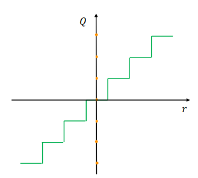
</center>

\begin{align}
q &= \mathbf{Q}(r) = \text{clip}(\left\lfloor \frac{r}{s} \right\rceil + z, q_\min, q_\max) \\
r &\approx \mathbf{D}(q) = s(q - z)  \\
\\
\text{where} \\
\mathbf{Q} &= \text{"the quantization operator"}\\
\mathbf{D} &= \text{"the de-quantization operator"}\\
q &= \text{"quantized value"}\\
r &= \text{"real value"}\\
s &= \text{"the real difference between quantized steps"} \in \mathbb{R} \\
z &= \text{"the quantized value mapping to real number 0"} \in \mathbb{Z}
\end{align}

The precise definition of the scaling factor $S$ and zero point $Z$ varies with which quantization scheme is utilized.

> **Note**
> This mapping is simple and efficient to implement, making it the default choice in most frameworks. This is also the most common scheme used in hardware accelerators.

#### 3.1.2 Non-Uniform Quantization
Non-uniform quantization (e.g., logarithmic, power-of-2) uses varying step sizes, which can better approximate values with wide dynamic ranges.
<center>
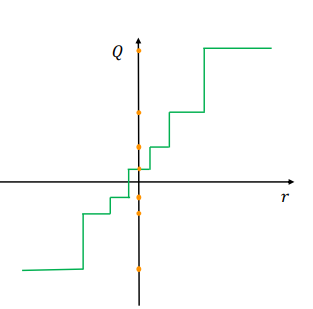
</center>
\begin{align}
q &= \mathbf{Q}(r) = \text{sign}(r) \cdot \text{clip}(\left\lfloor -\log_2{\frac{|r|}{s}} \right\rceil + z, q_\min, q_\max) \\
r &\approx \mathbf{D}(q) = s \cdot 2^{z-q}
\end{align}
> **Note**
> Pros: more compact for data with exponential distribution (e.g., speech/audio energy, some vision features).
> Cons: less common in mainstream hardware, harder to accelerate.

### 3.2 By Symmetry

#### 3.2.1 Symmetric Uniform Quantization
Symmetric quantization enforces zero-centered ranges for both positive and negative values.

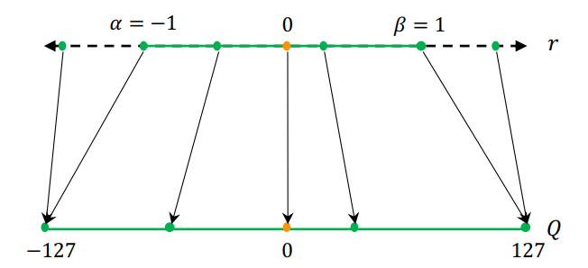

\begin{align}
\beta &= -\alpha \text{ (symmetric)} \\
s &= \frac{2 \max(|\alpha|, |\beta|)}{q_\max - q_\min} \\
z &= 0 \text{ (signed)} \quad \text{or} \quad 128 \text{ (unsigned)}
\end{align}
> **Note**
> Typically used for weights because:
> * Weight distributions are often symmetric around 0.
> * Having $Z = 0$ makes computations simpler (fewer cross terms).
> * Hardware kernels (e.g., GEMM/Conv) become easier to optimize.

#### 3.2.2 Asymmetric Uniform Quantization
Asymmetric quantization allows a nonzero zero-point to better represent skewed distributions.

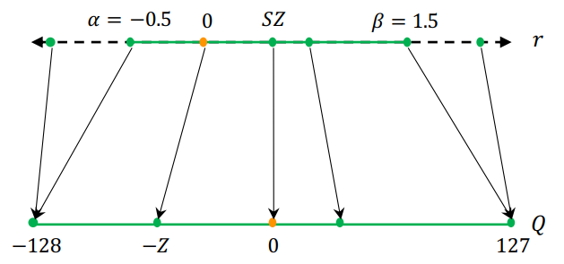

\begin{align}
\beta &\ne -\alpha \text{ (asymmetric)} \\
s &= \frac{\beta - \alpha}{q_\max - q_\min} \\
z &= q_\min - \left\lfloor \frac{\alpha}{s} \right\rceil
\end{align}

> **Note**
> * Common for activations, especially ReLU outputs (range $\ge 0$).
> * Example: unsigned INT8 (0–255) efficiently covers positive-only activations.
> * Provides better accuracy when data distribution is not symmetric.

#### 3.2.3 Faster Matrix Multiplication Comparison
This introduces additional subtraction operations, increasing the computational cost.
* **Symmetric quantization (e.g., weights):** simple integer-only multiply-accumulate.

* **Asymmetric quantization (e.g., activations):** requires extra subtractions, slightly higher cost.

> **Tip**
> Software libraries (e.g., cuBLAS, MKL) often prefer symmetric quantization for kernels. Hardware accelerators can support asymmetric quantization for activations because the accuracy gain outweighs the slight overhead.

### 3.3 By Number Representation
So far, we mainly discussed quantization to INT (e.g., INT8). But quantization to FP formats (e.g., FP16, BF16, FP8) is also widely used.

#### 3.3.1 Quantization to INT
Fixed scaling factor ($S$) + integer representation.
* **Pros:** very efficient on integer ALUs (CPUs, DSPs, NPUs).
* **Cons:** limited dynamic range, requires careful calibration.
* **Typical use:** deployment on mobile and edge devices.

#### 3.3.2 Quantization to FP
Reduced-precision floating point (FP16, BF16, FP8).
* **Pros:** much larger dynamic range than INT8, no need for per-tensor zero-point.
* **Cons:** higher power/area cost than INT.
* **Typical use:**
    * Training using FP16/BF16 mixed precision to speed up convergence.
    * Inference in large models (e.g., FP8 for LLMs) where INT8 may lose accuracy.

### 3.4 Summary of Usage Scenarios

| Data Type | Typical Scheme | Reason |
| -------- | -------- | -------- |
| Activations | Unsigned Asymmetric (e.g., 0–255 INT8) | Fits ReLU outputs ($\ge 0$), avoids wasting half the range on negatives. |
| Weights | Signed Symmetric (e.g., –128 to 127 INT8) | Weight distribution is symmetric, simplifies hardware ops. |
| Bias/Scales | Often kept in FP32 or INT32 | Prevents accumulation overflow, maintains numerical stability. |
| Training | FP16 / BF16 | Preserves range and gradient precision while saving memory. |
| Large models (LLMs) | FP8 / mixed precision | Balances accuracy with memory efficiency, avoids INT8 underflow. |

---

## 4. Range Determination
In the quantization process, we need to determine how real values are mapped to a finite integer range. This involves clipping (defining the real-value range) and the integer mapping range (full range vs. reduced range).
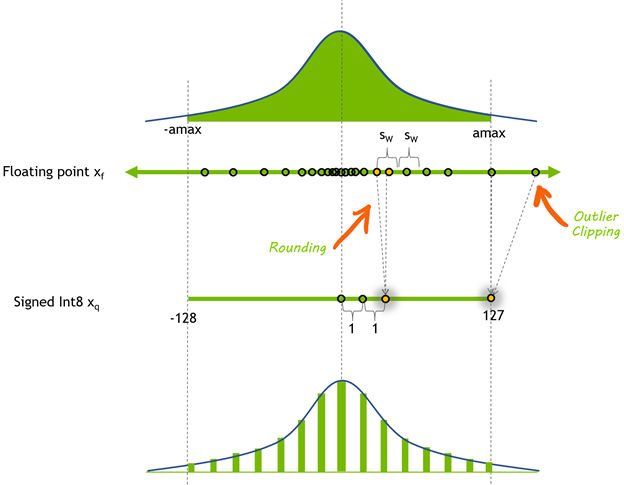

\begin{align}
\text{clipping range} &= [\alpha, \beta] \\
\text{dynamic range} &= [r_\min, r_\max]
\end{align}

### 4.1 Min-Max Clipping
For min-max clipping, the clipping range equals the dynamic range: $[x_{min}, x_{max}]$.

\begin{align}
\alpha &= r_\min \\
\beta &= r_\max
\end{align}

> **Note**
> The drawback of min-max clipping is that it's sensitive to outliers. A single extreme value can significantly widen the range, reducing precision for most values.

### 4.2 Moving Average Clipping
Smooths the range over time to avoid sudden fluctuations caused by individual batches:

\begin{align}
\alpha_t &=
\begin{cases}
    r_\min &\text{if } t=0 \\
    c\ r_\min + (1-c) \alpha_{t-1} &\text{otherwise}
\end{cases} \\
\beta_t &=
\begin{cases}
    r_\max &\text{if } t=0 \\
    c\ r_\max + (1-c) \beta_{t-1}  &\text{otherwise}
\end{cases}
\end{align}

### 4.3 Percentile Clipping
Ignores extreme outliers by keeping only a percentile range of the distribution (e.g., 5% ~ 95%). 
\begin{align}
\alpha &= P_{5}(r)\\
\beta &= P_{95}(r)
\end{align}
This improves precision for the majority of values.

### 4.4 Reduced vs Full Range
Next, we consider the integer mapping range.
* **(a) Full Range:** Uses the entire integer space. Example for 8-bit signed: $[-128, 127]$.
* **(b) Reduced Range:** Intentionally leaves out the smallest value: $[-127, 127]$. Although it differs by only one value, this ensures symmetry between negative and positive sides, simplifying zero-point alignment and hardware implementation.

### 4.5 Clipping vs Clamping
* **Clipping:** Defines the real-value range before quantization. Example: limit input values to $[-1, 1]$; any values outside are truncated.
* **Clamping:** Ensures the quantized integer values stay within the integer range. Example: INT8 signed full range $\rightarrow$ `clamp(x, -128, 127)`.

---

## 5. Calibration Methods
The process of choosing the input clipping range is known as calibration. The simplest technique (also the default in PyTorch) is to record the running minimum and maximum values and assign them to $x_{min}$ and $x_{max}$.

In PyTorch, Observer modules collect statistics on the input values and calculate the qparams `scale` and `zero_point`. Different calibration schemes result in different quantized outputs, and it’s best to empirically verify which scheme works best for your application and architecture.

### 5.1 Weight-only Quantization
In weight-only quantization, only weights are quantized, while activations remain in full-precision (FP32).

### 5.2 Static Quantization
In static quantization approach, both weight's and activation's clipping range are pre-calculated and the resulting quantization parameters remain fixed during inference. This approach does not add any computational overhead during runtime.

### 5.3 Dynamic Quantization
In dynamic quantization, activation's clipping range as well as the quantization parameters are dynamically calculated for each activation map during runtime. This approach requires run-time computation of the signal statistics (min, max, percentile, etc.) which can have a very high overhead.

### 5.4 Comparison
| | Weight-only quantization | Static quantization | Dynamic quantization |
| -------- | -------- | -------- | -------- |
| calibrate on weights | before inference | before inference | before inference |
| quantize on weights | before inference | before inference | before inference |
| calibrate on activations | no | before inference | during inference |
| quantize on activations | no | during inference | during inference |
| runtime overhead | no | low | high |

> **Tip**
> * **Calibrate:** Determine the range (scale and zero point) for mapping floating-point values into integers. (決定要把浮點數壓到整數時，採用什麼範圍。)
> * **Quantize:** Actually map floating-point values into integers using the chosen range parameters. (把浮點數真的轉成整數表示。)

---
## 6. Implementation Techniques(Fake vs. Integer-only)

After defining the quantization schemes and understanding the trade-offs in range, symmetry, and uniformity, it is important to look at how quantization is practically implemented in machine learning frameworks and hardware accelerators. Two common approaches are fake quantization and integer-only quantization, each serving different purposes.

### 6.1 Fake Quantization(Simulated Quantization)

Fake quantization, also known as simulated quantization, is primarily used during training or model conversion to approximate the behavior of quantization without actually changing the underlying computation precision.

<center>

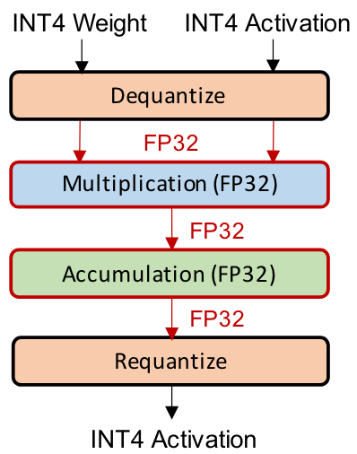

</center>
    
Model parameters (weights, activations) are stored in low precision (e.g., INT8). However, when operations such as matrix multiplications and convolutions are performed, they are still executed in floating-point (FP32 or FP16). Before computation, the quantized values are dequantized back to floating point.

This approach allows developers to estimate the performance drop caused by quantization and to fine-tune the model accordingly. It is also commonly used in Quantization-Aware Training (QAT), where the model learns to adapt to quantization effects.
Thus, fake quantization acts as a bridge between the full-precision training world and the low-precision inference world.

> **Note**
> * **Pros:** Easy to integrate into existing floating-point pipelines. Provides accurate estimation of quantization error.
> * **Cons:** No real computational savings, since hardware operations remain in floating point.
> 
> 

### 6.2 Integer-only Quantization(Hardware Deployment)

Integer-only quantization enforces that all operations—including convolutions, fully connected layers, and accumulations—are performed directly in low-precision integer arithmetic.

Both weights and activations are quantized to integers (e.g., INT8). The multiplications and additions are carried out in integer arithmetic, and only the final outputs may be rescaled or converted back to floating point if needed.
This is the approach used in deployment on edge devices, DSPs, and custom accelerators, where reducing memory bandwidth, latency, and energy consumption is critical.

> **Note**
> * **Pros:** Achieves significant speedup and energy efficiency. Which also reduces model size and memory bandwidth usage.
> * **Cons:** More sensitive to quantization error, requiring careful calibration and per-layer scaling strategies.
> 
> 

---
## 7. Quantization Workflows
Quantization can be applied to neural networks at different stages of the training–deployment pipeline. The two most common workflows are Post-Training Quantization (PTQ) and Quantization-Aware Training (QAT). They differ in accuracy, complexity, and hardware-friendliness.

### 7.1 Post-Training Quantization (PTQ)
In PTQ, quantization is applied after the model has already been trained in floating point.
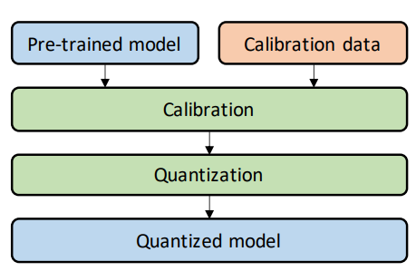

The trained model’s weights and activations are directly mapped to lower precision (e.g., INT8) without re-training. Calibration data is often used to determine optimal scaling factors. PTQ is suitable when training data or computational resources are limited, but may not meet accuracy requirements in all scenarios.

> **Note**
> * **Pros:** Fast and easy to apply which no need for additional training. Besides, PTQ is well supported by most ML frameworks (TensorFlow Lite, PyTorch, etc.).
> * **Cons:** Accuracy degradation may be significant, especially for complex models like transformers or models with sensitive layers.

### 7.2 Quantization-Aware Training (QAT)
QAT addresses the accuracy drop problem of PTQ by incorporating quantization during training.
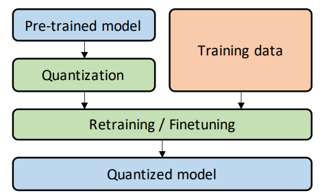

During forward propagation, fake quantization is inserted: weights and activations are quantized and then dequantized, so the network "sees" the effect of quantization. During backward propagation, gradients are computed with special techniques to allow training despite quantization being non-differentiable.

> **Note**
> * **Pros:** Provides much higher accuracy compared to PTQ, often close to full-precision models. Enables deployment on integer-only hardware without retraining.
> * **Cons:** Requires access to the training data and more computational cost. Training is more complex and time-consuming.

#### 7.2.1 Straight-Through Estimator (STE)
One of the key challenges in QAT is that the quantization function (e.g., rounding) is non-differentiable. Standard backpropagation cannot pass gradients through these discrete operations. 
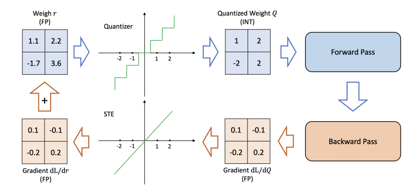

Instead of trying to compute the true gradient of the quantization function (which is zero almost everywhere), the STE simply approximates the gradient as if the quantization step were an identity function in the backward pass.

\begin{align}
\text{Forward: } q(x) = \text{round}(\frac{x}{s}) \times s \\
\text{Backward: } \frac{\partial L}{\partial x} \approx \frac{\partial L}{\partial q(x)}
\end{align}
This trick allows training to continue normally, so the model can learn parameters that are robust to quantization noise.

### 7.3 Quantization in Practice
In this section, we will demonstrate how to perform quantization with PyTorch framework with a simple yet 
comprehensive example.
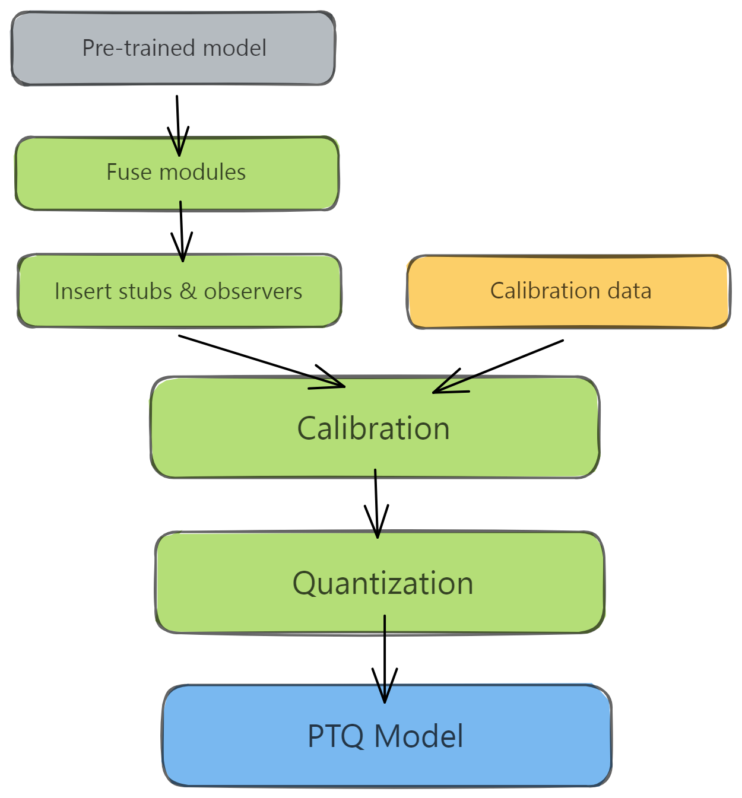

Let's discuss the quantization process using PyTorch step by step:

#### Step1. Calibration Data
During calibration, only a small amount of data is required. Therefore, the batch size is set to 1.
```python
dataset = '{DATASET}'
backend = '{Quantization_scheme}'
model_path = 'path/to/your/model'
_, _, test_loader = DATALOADERS[dataset](batch_size=BATCH_SIZE)
python
```

#### Step2. Pre-trained Model 
Load model weights trained from Lab 1.1.

```Python
model = network()
model.load_state_dict(torch.load(model_path))
```
#### Step3. Customize Quantization Scheme
Configure Quantization:

```Python
model.qconfig = CustomQConfig.{CustomQConfig_class}.value
print(f"Quantization backend: {model.qconfig}")
```

QConfig Setup:
```Python
class CustomQConfig(Enum):
    CusQuant = torch.ao.quantization.QConfig(
                activation=CusQuant.with_args(
                    dtype=torch.quint8,
                    qscheme=torch.per_tensor_symmetric
                ),
            weight=CusQuant.with_args(
                dtype=torch.qint8,
                qscheme=torch.per_tensor_symmetric
                ),
            )
    DEFAULT = None
```

The `torch.ao.quantization.QConfig` class helps define custom quantization schemes by specifying:

* How activations should be quantized
* How weights should be quantized

These are parameters tells your custom observer class `CusQuant()` how to calculate scale and zero point.

| Parameter | Description |
| --- | --- |
| `dtype=torch.quint8` | unsigned 8-bit quantization |
| `dtype=torch.qint8` | signed 8-bit quantization |
| `qscheme=torch.per_tensor_symmetric` | select symmetric quantization in one tensor |
| `qscheme=torch.per_tensor_affine` | select asymmetric quantization in one tensor |

#### Step4. Operator Fusion

Operator fusion is a technique that combines multiple operations into a single efficient computation to reduce memory overhead and improve execution speed.

> Module fusion combines multiple sequential modules (eg: `[Conv2d, BatchNorm, ReLU]`) into one. Fusing modules means the compiler needs to only run one kernel instead of many; this speeds things up and improves accuracy by reducing quantization error.
> – PyTorch

Common fusions include:

* `Conv2D + BatchNorm + ReLU` -> Fused into a single Conv2D operation.
* `Conv2D + ReLU`  -> Fused into a single Conv2D operation.
* `Linear + ReLU` -> Fused into a single linear transformation with an activation function.

If you want to perform module fusion to improve performance, you should call the following API before calibration.

```python
torch.ao.quantization.fuse_modules(model: nn.Module, modules_to_fuse: list[str], inplace=False) -> nn.Module

```

You can see the reference for more details.

> **Warning (Critical Step!)**
> Operator fusion must be performed on the CPU, and the model should be switched to evaluation mode before fusing.
> ```python
> model.eval()
> model.cpu()

#### Step5. Insert Observer

* `torch.ao.quantization.prepare(model)` : Inserts fake quantization modules to track activations at PTQ.
* `torch.ao.quantization.prepare_qat(model)` : Inserts fake quantization modules to track activations at QAT.

```python
torch.ao.quantization.prepare(model)      # PTQ
torch.ao.quantization.prepare_qat(model)  # QAT

```

#### Step6. Calibration

Define calibration function first:

```python
def calibrate(model, loader, device=DEFAULT_DEVICE):
    model.eval().to(device)   
    for x, _ in loader:       
        model(x.to(device))  
        break                 

```

Apply calibration by directly call the above function after inserting the observer via `torch.ao.quantization.prepare`.

```python
calibrate(model, test_loader, device='cpu')

```

This runs one batch of data (previous step) through the model to collect activation statistics.

#### Step7. Quantization

Use `torch.ao.quantization.convert(model.cpu())` to convert the model into a fully-quantized model.

```python
torch.ao.quantization.convert(model.cpu())

```

> **Warning (Critical Step!)**
> Operator convert must be performed on the CPU, and the model should be switched to evaluation mode before quantization.
> ```python
> model.eval()
> model.cpu()
> 
> ```

Finally, save your quantized model with given filename

```python
save_model({Your Model}, "filename.pth")

```

**Mode comparison**

| Step | API (PyTorch) | PTQ | QAT |
| --- | --- | --- | --- |
| Fuse | `fuse_modules` | CPU / Eval | CPU / Eval |
| Prepare | `prepare` / `prepare_qat` | CPU / Eval | CPU / Train |
| Calibration | NA | CPU / Eval | CPU / Train |
| Convert | `convert` | CPU / Eval | CPU / Eval |

### Reference

* A Survey of Quantization Methods for Efficient Neural Network Inference: `arXiv.2103.13630`
* ACIQ: Analytical Clipping for Integer Quantization of neural networks: `arXiv.1810.05723`
* SAWB: Bridging the accuracy gap for 2-bit quantized neural networks: `arXiv.1811.01432`
* XNOR-Net: ImageNet Classification Using Binary Convolutional Neural Networks: `arXiv.1603.05279`
* PyTorch Quantization Official Documents
* NVIDIA Deeplearning Performance Documents

---

## 8. Quantization Errors and Metrics

<center>

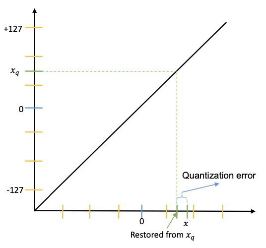

</center>


A metric to evaluate the numerical error introduced by quantization.

$$ \mathbf{L}(r, \hat{r}) \text{ , where } r \approx \hat{r} = \mathbf{D}(\mathbf{Q}(r)) $$

where $r$ is the original tensor, $\hat{r} = \mathbf{D}(\mathbf{Q}(r))$ is the tensor after quantization and dequantization.

### 8.1 Mean-Square Error (MSE)

The most commonly-used metric for quantization error.


$$L(r, \hat{r}) = \frac{1}{N} \sum_{i=1}^{N}(r_i - \hat{r}_i)^2$$

### 8.2 Cosine Distance

Cosine distance measures the directional difference between two vectors, ignoring their magnitudes. It is commonly used in quantization error analysis to evaluate how well the direction of a vector is preserved after quantization.


$$d_{cosine}(x,y) = 1 - \frac{x \cdot y}{\Vert{}x\Vert{}\Vert{}y\Vert{}}$$

### 8.3 Other Metrics

* Pearson correlation coefficient
* Hessian-guided metric


---

##  Implementation Requirements

### 1. Dataset, Environment & File Structure Overview

**Dataset:** CIFAR‑10 (torchvision)
**Framework:** PyTorch 2.6.0 + CUDA Toolkit 12.9
**Backend:** fbgemm (x86)
**Hardware:** CPU required for int8 inference; CUDA is optional for baseline training.

**File Structure Overview:**
Because there is no dedicated lab lecture this year, please read this carefully to understand your tasks:

* `StudentID_Lab3.ipynb`: The main notebook where you will implement everything. All placeholder comments `##### YOUR CODE HERE #####` must be filled in with your implementation.
* `weights/`: The directory where you must save your trained `.pth` files.
* `StudentID_Lab3_Report.md`: Your final report detailing your design justification and trade-off analysis.

### 2. Tasks

Complete the following tasks inside `StudentID_Lab3.ipynb`.
All placeholder comments `##### YOUR CODE HERE #####` must be filled in with your implementation except block Custom Learning Rate Schedule.

**A. Dataset & Preprocessing**

* Implement data augmentation for training in `get_cifar10_loaders` to enhance the variety of data fed into the model.
* Implement the evaluation transform for data preprocessing in `get_cifar10_loaders`.

**B. ResNet-50 Model Implementation**

* Implement the forward passes and layer fusion operations in `QuantizableBasicBlock` and `QuantizableBottleneck`.
* Complete the forward method of `QuantizableResNet` using `QuantStub` and `DeQuantStub`.
* Verify architecture with `torchsummary.summary`.

> **Special Handling for Residual Connections (Add + ReLU)**
> In models like ResNet, residual connections perform an element-wise add operation, which is often followed by a ReLU.
> **Standard `torch.add` or `+` operators will not be automatically fused with ReLU during the quantization process.** To ensure these operations are correctly quantized and fused, PyTorch provides a dedicated module: `nn.quantized.FloatFunctional`. You should use this in your model's forward pass to merge the residual and identity connections.

> **Tip**
> You can refer more details at Lab2 to finish the code. ResNet-50 Reference Architecture.

**C. Training**
Finish the training loop in `train_model()`:

* Choose a loss function, an optimizer, and a learning-rate scheduler.
* Log the training and validation loss and accuracy at each epoch.
* Save the best-performing FP32 model.
* Plot the loss and accuracy curves.

> **Tip**
> Methods to increase accuracy:
> * Adjust the training parameters including EPOCHS, LEARNING_RATE, BATCH_SIZE, and VAL_TRAIN_SPLIT_RATIO.
> * Design your own scheduler in block Custom Learning Rate Scheduler.
> * Use a different criterion or optimizer.
> 
> 

**D. Post-Training Quantization (PTQ)**
Implement the full PTQ workflow:

* Load CIFAR-10 validation set
* Load pretrained FP32 model
* Fuse model layers
* Set quantization config
* Prepare model for PTQ
* Calibrate the model using the validation data with your own `calibrate()`.
* Convert model to INT8
* Save quantized model

> **Caution**
> At the PTQ workflow, you must use the customized quantization function `CustomQConfig.CusQuant.value`.

**E. Quantization-Aware Training (QAT)**
Implement the full QAT workflow:

* Load the CIFAR-10 dataloaders
* Load pretrained FP32 model
* Fuse model layers
* Assign QAT qconfig
* Prepare model for QAT
* Train with QAT
* Convert to INT8 model
* Save quantized model

> **Caution**
> At the QAT workflow, you must use the customized quantization function `CustomQConfig.CusQuant.value`.

### 3. Grading Criteria

**Stage A: ResNet-50 FP32 Baseline (20%)**

* 5% – Implement the ResNet-50 model correctly
* 15% – Achieve baseline accuracy thresholds

**Stage B: PTQ — Static Post Training Quantization (25%)**

* 5% – Implement your customized quantization function
* 5% – Implement the PTQ workflow correctly
* 5% – Quantized model size $\le$ 25 MB
* 10% – Quantized model accuracy drop compared to the FP32 model

**Stage C: QAT — Quantization Aware Training (20%)**

* 5% – Implement the QAT workflow correctly
* 5% – Quantized model size $\le$ 25 MB
* 10% – Quantized model accuracy drop compared to the FP32 model

**Stage D: Report (35%)**

* 35% – Complete and submit a comprehensive report.
* **Trade-off Analysis Requirement:** Your report MUST include a table comparing Model Size (MB), Final Accuracy (%), and Accuracy Drop (%) for FP32, PTQ, and QAT. You must justify your architecture decisions (e.g., why specific layers were fused) and discuss whether the performance degradation is an acceptable trade-off for the hardware savings.


